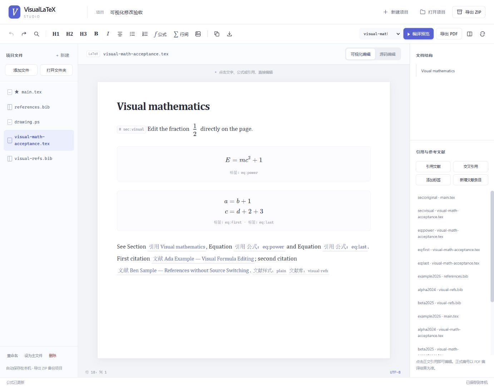

# VisualLaTeX Studio

**Import a document, edit it visually, then export—with multiple files, PostScript and local PDF compilation.**

The workspace centers the manuscript, with compact editing and compile controls, consistent icons, paper typography, and focused dialogs. Formula confirmation stays visible in the dialog footer.



VisualLaTeX Studio continues VisualLaTeX's purpose of visually modifying existing LaTeX documents, adding full source access, multiple files, references, bibliography entries, ZIP projects and real compilation. It bundles MathLive 0.111.1 (MIT) and its fonts for formula editing. Offline editing needs no npm installation or build step. Compilation uses Node.js 22+ and a local typesetting toolchain. The static page and the local service share the same frontend; compilation, PDF preview and export are available only through the local service.

**Complete LaTeX documents open in Visual editing by default.** Edit text and headings directly and use the formatting toolbar. Click a typeset formula to edit fractions, superscripts and subscripts in a graphical math field. References and labels appear as readable items that open an editor when clicked, without switching to source. Untouched source stays intact, and the current session remembers the selected editing mode for each file.

Source editing remains available for preambles, custom macros and complex structures. Bibliography files, PostScript, TeX fragments and incomplete documents use source editing without forced visual conversion. PostScript supports source editing and rendering; arbitrary PS graphics cannot yet be modified as visual objects.

## Start

The sample project contains `main.tex`, `references.bib` and `drawing.ps`. The same frontend supports two ways to run:

| Mode | Open or start | Available |
| --- | --- | --- |
| Static page | Open `index.html`, or visit GitHub Pages | Visual and source editing, multi-file projects, import/export, local drafts; no compilation |
| Local service | `node server/server.mjs`, or `scripts/start.ps1` on Windows | Everything in the static page, plus LaTeX / PostScript compilation, PDF preview and export |

Open `index.html` when you only need to edit; start the local service below for compilation, preview or PDF export.

### Windows

Install [Node.js 22 or newer](https://nodejs.org/en/download), unpack this project and run PowerShell in its directory:

```powershell
.\scripts\setup-windows.ps1
.\scripts\start.ps1
```

If PowerShell blocks scripts under its default policy, use `powershell -NoProfile -ExecutionPolicy Bypass -File .\scripts\setup-windows.ps1` for that invocation, and likewise for `scripts\start.ps1`. No system policy change is required.

Setup downloads pinned official Tectonic 0.17.0, Ghostscript 10.08.0 and extraction tools, verifies their published SHA-256 digests, and unpacks them under `.tools` in the project root. It never runs the installers, changes the registry, or overwrites project files. Existing tools are retained on subsequent runs; failed downloads and staging files remain available for inspection. Third-party engine binaries are not distributed in this source archive; their licenses remain in their download packages.

Open the address printed by the terminal, normally `http://127.0.0.1:4173`. Keep the terminal running and press Ctrl+C to stop. Use `.\scripts\start.ps1 -Port 4174` to choose another port.

### macOS, Linux or an existing toolchain

Install [Tectonic](https://tectonic-typesetting.github.io/book/latest/installation/index.html) or XeLaTeX and [Ghostscript](https://ghostscript.com/releases/gsdnld.html), make their executables available on PATH, then run:

```bash
node server/server.mjs
```

Executable paths can also be supplied using `VISUALLATEX_TECTONIC`, `VISUALLATEX_XELATEX`, and `VISUALLATEX_GHOSTSCRIPT`. XeLaTeX bibliography tools accept `VISUALLATEX_BIBTEX` and `VISUALLATEX_BIBER`. Set XeLaTeX explicitly to choose an existing TeX distribution; do not configure both LaTeX engines at once.

Tectonic downloads missing TeX support files on first use and caches them for later compilation. Source is compiled locally and is not uploaded to a third-party service. The Windows launcher uses `.tools/cache`; `TECTONIC_CACHE_DIR` overrides this location. Existing TeX distributions manage their own packages and fonts.

### Editing and PDF output

- Add individual files, open a project folder, or import a ZIP project.
- Complete LaTeX documents open in Visual editing: modify text and headings directly, use the formatting toolbar, or click formulas, references and labels to edit them.
- Switch to Source editing for preambles, custom macros and complex structures, then return to visual editing. Fragments, BibTeX, PostScript and EPS text remain directly editable source.
- Download one file or export the entire project as ZIP, including binary resources and changes in inactive files.
- Select the complete LaTeX main document or a PS/EPS file, then compile/render with the button or Ctrl/Cmd+Enter.
- Inspect the generated PDF and export it. The PDF pane displays the result; modify content in the editor. Running tasks can be cancelled; errors retain engine logs for diagnosis.

Source changes mark an older PDF as stale. Export recompiles changed content before downloading, while failed compilation keeps the previous preview visibly marked and leaves the source editable. With Ghostscript installed, pages are displayed as images using Previous/Next controls, without requiring a browser PDF plugin. Without Ghostscript, the UI explains the limitation and falls back to native PDF display; the complete PDF remains exportable.

Image preview supports the first 100 pages on a fixed 1200×1600 canvas with each complete page fitted proportionally. This does not change the exported PDF's page dimensions, vector content or page count. Images are generated on demand with a 20-second limit and can be retried after failure. Use the exported PDF to select or copy text.

Direct `file://` pages and GitHub Pages remain editing-only. Browser drafts are isolated by origin: export a ZIP from the old offline page before switching to the local service, then import it there.

Opening a folder or project replaces the current workspace after confirmation. Adding individual files preserves existing files and assigns new names to duplicates. Renaming a path does not rewrite source references automatically.

## Features

| Feature | Support |
| --- | --- |
| Visual editing | Default for complete LaTeX documents; edit text, headings, formatting, lists, formulas, references and labels |
| Graphical math | Typeset formulas with click-to-edit fractions and scripts; inline/display math and equation, align and gather environments, including starred variants |
| Source files | TeX, LaTeX, STY, CLS, BIB, PS, EPS and UTF-8 text with custom extensions |
| Project management | Create, rename, delete, select main file and preserve relative paths |
| References | Readable, clickable cite/ref/label items; select project labels and BibTeX entries, edit keys and optional notes, and add bibliography entries |
| Find and replace | Current-file search, wrap-around, replace one/all and case sensitivity |
| History | Independent per-file undo/redo for source and visual changes |
| PostScript | PS/text EPS source, page/procedure outline, templates, UTF-8 and Latin-1; no arbitrary PS graphics object editing |
| Resources | Preserve original binary bytes, including binary EPS |
| Archives | Read stored/deflated ZIP and export standard ZIP without packages |
| Drafts | Atomic local project snapshots and legacy single-file migration |
| LaTeX compilation | Local service only: Tectonic or XeLaTeX with project files, resources, references and bibliography processing |
| PostScript rendering | Local service only: Ghostscript converts PS/EPS to PDF; EPS uses BoundingBox cropping |
| PDF output | Local service only: target selection, preview, cancellation, logs, stale-result tracking and current-source export |

Reference displays use section titles, label keys and BibTeX metadata such as authors, titles and years to identify targets. They do not claim to show compiled citation numbers or page numbers. The compiled PDF determines final numbering, bibliography style and typesetting.

The formula dialog provides graphical math input and fields for labels and explicit tags. Formula delimiters, environment names and unchanged source are preserved; labels and tags in multiline formulas remain associated with their rows. Use the dialog's advanced input or Source editing for custom macros and complex expressions unsupported by the renderer. Other unsupported visual structures remain editable raw TeX. New `main.tex` files have a document template; other TeX files start empty for use as fragments.

Shortcuts: Ctrl/Cmd+S saves locally, Ctrl/Cmd+F opens find/replace, Ctrl/Cmd+Z undoes, Ctrl/Cmd+Shift+Z or Ctrl+Y redoes, Ctrl/Cmd+Enter compiles/renders, and Tab inserts two spaces. The encoding button explicitly switches UTF-8/Latin-1; unencodable characters are rejected rather than replaced.

## Limits

Projects allow 500 files and 50 MB of expanded content; ZIP input allows 100 MB. Encrypted, multi-disk and ZIP64 archives are unsupported. Browser storage quotas may be smaller; export ZIP backups for larger projects. Undo history is session-local.

Project name, main file and active file are stored in the ZIP comment without reserving or replacing any user filename. Third-party repacking may remove these settings; project source and resources can still be imported.

Compilation is explicit and has a default 180-second timeout; initial support-file downloads may take longer. Tectonic performs TeX/BibTeX passes automatically. BibLaTeX/Biber projects should use XeLaTeX with Biber installed. CJK and custom fonts must be available to the toolchain. Packages requiring shell escape, such as some minted workflows, are unsupported. Full typesetting and diagnostics come from the engine; the visual editor is not a complete TeX parser.

Font validation limitation: with Tectonic 0.17.0 and the default ctex/Fandol fonts, the tested Chinese PDF looked correct but copied/extracted text had incorrect character mappings. On Windows with the corresponding system fonts installed, explicitly using `\usepackage[UTF8,fontset=windows]{ctex}` restored text copying in the tested sample. The application never changes project font settings automatically; other platforms and font combinations need separate verification.

The service binds only to loopback and validates Host, Origin and a session token. Temporary project directories are removed after jobs finish. Tectonic uses `--untrusted`, XeLaTeX disables shell escape, and Ghostscript uses `SAFER`. These options **are not an operating-system sandbox**: compile trusted local projects, and do not expose this service as a public compilation server.

## Development

Node.js 22+, no npm installation:

```bash
node --check src/js/main.js
node --check src/js/workspace.js
node --check src/js/project-model.js
node --check src/js/project-archive.js
node --check src/js/preview.js
node --check src/js/visual-math.js
node --check src/js/visual-references.js
node --check src/js/visual-references-ui.js
node --check vendor/mathlive/mathlive.min.js
node --check server/compiler.mjs
node --check server/pdf-preview.mjs
node --check server/server.mjs
node tests/smoke.mjs
node --test
```

Tests exercise actual functions and UI event handlers, compiler process orchestration, loopback service boundaries, cancellation and stale results. New regressions cover display-only formula/reference changes preserving source, edits confined to the selected reference command, math delimiters, environments and labels, legacy draft snapshot migration, visual reference interactions, and the local server's script/font allowlist. Regular tests use simulated engines and do not need the toolchain. The minimal DOM model does not verify browser layout or actual TeX/PS typesetting. CI checks `main`/`dev`; publishing and deployment wait for checks. GitHub Pages serves only the static editor.

The pinned MathLive scripts, styles, fonts and license are in `vendor/mathlive/`. Its [manifest.json](vendor/mathlive/manifest.json) records the version, download source, package integrity and each file's SHA-256. These assets load locally without a CDN.

See the [browser acceptance checklist](tests/browser-acceptance.md) for manual end-to-end validation. Actual engine validation in this iteration used Tectonic and Ghostscript; the XeLaTeX path has not yet been verified against a real distribution.

`src/js/workspace.js` coordinates editing, `src/js/project-model.js` owns canonical source/history/indexes, and `src/js/project-archive.js` handles ZIP. `src/js/visual-math.js`/`src/css/visual-math.css` adapt MathLive for formula rendering and editing; `src/js/visual-references*.js`/`src/css/visual-references-ui.css` provide reference semantics, readable displays and editing dialogs. `src/js/preview.js` manages PDF state and export; `server/compiler.mjs` and `server/server.mjs` run the local compilation service, while `server/pdf-preview.mjs` renders bounded page images. `scripts/setup-windows.ps1` and `scripts/start.ps1` prepare portable tools and start the service. The original `src/js/main.js` remains the visual LaTeX conversion core.

### Project layout

The static page depends only on `index.html`, `src/` and `vendor/`; `server/`, `scripts/` and `tests/` support local compilation, tool installation and development.

```
index.html                         Workspace entry point
src/js/                            Frontend scripts
  main.js                          LaTeX parsing, conversion and visual editing core
  workspace.js                     Files, edit modes, find/replace and import/export
  project-model.js                 Source, project state, history and reference indexes
  project-archive.js               Dependency-free ZIP reader/writer
  visual-math.js                   Formula typesetting and graphical input
  visual-references.js             Reference semantics and indexes
  visual-references-ui.js          Reference editing dialog
  preview.js                       Compilation state, PDF preview and export
src/css/                           Frontend styles
  style.css                        Base LaTeX document typography
  workspace.css                    File workspace and editing area
  preview.css                      PDF preview and compile toolbar
  visual-math.css                  Formula display and editing
  visual-references-ui.css         Reference editing dialog
  studio.css                       Studio theme, layout and responsive overrides
  studio-dialogs.css               Workspace dialogs
vendor/mathlive/                   Pinned MathLive, fonts, license and manifest
server/server.mjs                  Loopback HTTP service and static asset allowlist
server/compiler.mjs                Tectonic / XeLaTeX compilation
server/pdf-preview.mjs             Paginated PDF image rendering
scripts/setup-windows.ps1          Portable Windows tool installation
scripts/start.ps1                  Windows launcher
tests/                             Zero-dependency regressions and browser checklist
screenshots/                       README screenshots
```

<details>
<summary><b>Version History</b></summary>

- **v2.1.0**: Studio workspace — complete visual editing, multi-file projects, direct formula and reference editing; local Tectonic/XeLaTeX and Ghostscript compilation, paginated PDF preview and export; bundled MathLive 0.111.1; Windows setup and launch scripts; frontend, server and scripts organized under `src/`, `server/` and `scripts/`; 291 `node --test` cases pass
- **v2.0.3**: fixed import data loss and HTML injection — the `.tex` parser now reads commands, environments, math and verbatim blocks, so untouched source blocks are preserved byte for byte; added `\(...\)` and `\[...\]` delimiters plus `\verb` and `\lstinline` support; double-click a visual formula to edit it; drafts are saved atomically with a version marker and flushed when the page is hidden, and legacy drafts are sanitized before restore; added 70 `node --test` regression tests
- **v2.0.2**: mobile and narrow-viewport adaptation — one panel per screen with bottom tabs switching between the editor and LaTeX code, toolbar collapsed into a single horizontally scrollable row with >=44px touch targets, `min-height:0` fix so the code preview is no longer clipped off-screen, `100dvh` and 16px inputs so iOS no longer zooms the page on focus; LaTeX conversion and export logic unchanged
- **v2.0.1**: maintenance release, main.js unchanged; license moved from MIT to Apache-2.0; UI restyled with design tokens and a warm-white academic theme, toolbar buttons switched to plain text; added CI checks and automatic GitHub Pages demo deployment
- **v2.0.0**: repositioned as a general offline LaTeX light editor; added .tex import; verbatim preservation of unsupported structures for lossless round-trips; fixed preamble not being cached with drafts and formulas losing user edits
- **v1.1.0**: visual editor + formula assistant for math-modeling papers (removed in v2.0.0)
- **v1.0.0**: initial release

</details>

## License

Project code uses [Apache-2.0](LICENSE), based on the original project by Escap1ng. Bundled MathLive 0.111.1 uses the [MIT license](vendor/mathlive/LICENSE.txt); its notice is included in the source archive.
