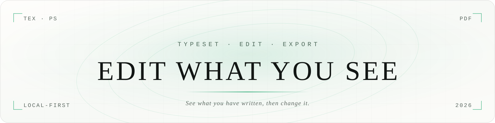
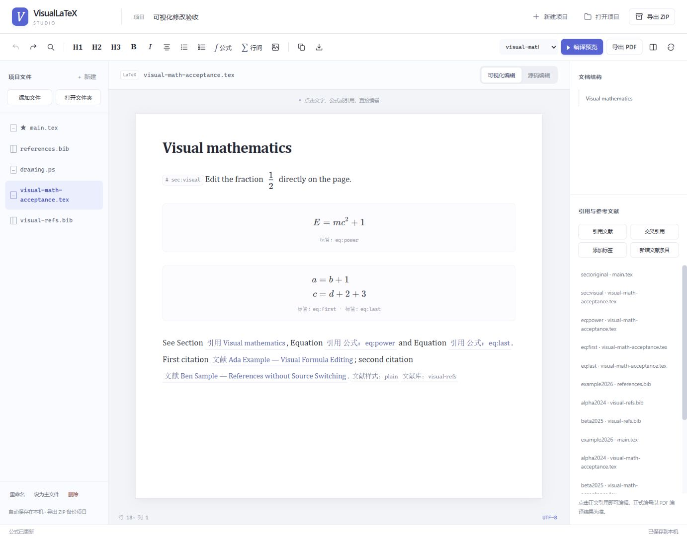

<p align="center">
  <picture>
    <source media="(prefers-color-scheme: dark)" srcset="assets/readme-hero-dark.svg">
    
  </picture>
</p>

<h1 align="center">VisualLaTeX Studio</h1>

<p align="center">
  <i>Vide quod scripsisti.</i><br>
  Visual editing for existing LaTeX documents, with local compilation and PDF export.
</p>

<p align="center">
  <a href="https://github.com/Escap1ng/VisualLaTeX/releases"></a>
  <a href="https://github.com/Escap1ng/VisualLaTeX/actions/workflows/ci.yml"></a>
  <a href="https://github.com/Escap1ng/VisualLaTeX/actions/workflows/deploy-pages.yml"></a>
  
  
  <a href="LICENSE"></a>
</p>

<p align="center">
  <strong>English</strong> · <a href="README.md">简体中文</a>
</p>

<p align="center">
  <a href="#overview">Overview</a> ·
  <a href="#quick-start">Quick start</a> ·
  <a href="#capabilities">Capabilities</a> ·
  <a href="#development">Development</a> ·
  <a href="#contributing">Contributing</a> ·
  <a href="#license">License</a>
</p>

---

## Overview

VisualLaTeX Studio works on existing LaTeX documents: import a project, edit text, headings, formatting and formulas directly, keep the complete source, multi-file structure, bibliography and ZIP resources, and compile with a local toolchain for real PDF output.

- **Visual first**: text, headings, lists, formulas, references and labels are editable in place; untouched source is preserved.
- **Two ways to run**: the static page focuses on editing; the local service adds LaTeX / PostScript compilation, PDF preview and export.
- **Local by design**: compilation, preview and export run only in the local service, and source is never uploaded; the formula editor and its fonts load offline from the repository.

Complete LaTeX documents open in Visual editing by default. Edit text and headings directly and use the formatting toolbar. Click a typeset formula to edit fractions, superscripts and subscripts in a graphical math field. References and labels appear as readable items that open an editor when clicked, without switching to source. Untouched source stays intact, and the current session remembers the selected editing mode for each file.

Source editing remains available for preambles, custom macros and complex structures. Bibliography files, PostScript, TeX fragments and incomplete documents use source editing without forced visual conversion. PostScript supports source editing and rendering; arbitrary PS graphics cannot yet be modified as visual objects.

<p align="center">
  
</p>
<p align="center"><sub>Workspace: file tree, visual manuscript, and the structure and reference panels.</sub></p>

## Quick start

The sample project contains `main.tex`, `references.bib` and `drawing.ps`. The same frontend supports two ways to run:

| Mode | Open or start | Available |
| --- | --- | --- |
| Static page | Open `index.html`, or visit GitHub Pages | Visual and source editing, multi-file projects, import/export, local drafts; no compilation |
| Local service | `node server/server.mjs`, or `scripts/start.ps1` on Windows | Everything in the static page, plus LaTeX / PostScript compilation, PDF preview and export |

Open `index.html` when you only need to edit; start the local service below for compilation, preview or PDF export.

### Windows

Install [Node.js 22 or newer](https://nodejs.org/en/download), unpack this project and run PowerShell in its directory:

```powershell
.\scripts\setup-windows.ps1
.\scripts\start.ps1
```

If PowerShell blocks scripts under its default policy, use `powershell -NoProfile -ExecutionPolicy Bypass -File .\scripts\setup-windows.ps1` for that invocation, and likewise for `scripts\start.ps1`. No system policy change is required.

Setup downloads pinned official Tectonic 0.17.0, Ghostscript 10.08.0 and extraction tools, verifies their published SHA-256 digests, and unpacks them under `.tools` in the project root. It never runs the installers, changes the registry, or overwrites project files. Existing tools are retained on subsequent runs; failed downloads and staging files remain available for inspection. Third-party engine binaries are not distributed in this source archive; their licenses remain in their download packages.

Open the address printed by the terminal, normally `http://127.0.0.1:4173`. Keep the terminal running and press Ctrl+C to stop. Use `.\scripts\start.ps1 -Port 4174` to choose another port.

### macOS, Linux or an existing toolchain

Install [Tectonic](https://tectonic-typesetting.github.io/book/latest/installation/index.html) or XeLaTeX and [Ghostscript](https://ghostscript.com/releases/gsdnld.html), make their executables available on PATH, then run:

```bash
node server/server.mjs
```

Executable paths can also be supplied using `VISUALLATEX_TECTONIC`, `VISUALLATEX_XELATEX`, and `VISUALLATEX_GHOSTSCRIPT`. XeLaTeX bibliography tools accept `VISUALLATEX_BIBTEX` and `VISUALLATEX_BIBER`. Set XeLaTeX explicitly to choose an existing TeX distribution; do not configure both LaTeX engines at once.

Tectonic downloads missing TeX support files on first use and caches them for later compilation. Source is compiled locally and is not uploaded to a third-party service. The Windows launcher uses `.tools/cache`; `TECTONIC_CACHE_DIR` overrides this location. Existing TeX distributions manage their own packages and fonts.

## Editing and export

1. Add individual files, open a project folder, or import a ZIP project.
2. Select a complete LaTeX document such as `main.tex` and edit text, headings and formatting in Visual editing; click formulas, references or labels to edit them. Switch to Source editing for custom macros and complex structures, then return to visual editing.
3. Download the current file, or export the entire project as ZIP including its resources.
4. Select a compile target: a complete LaTeX main document, or a `.ps` / `.eps` file, then compile/render with the button or Ctrl/Cmd+Enter.
5. Inspect the generated PDF and export it with Export PDF. The PDF pane displays the result; modify content in the editor. Failed compilation keeps engine logs available, and running tasks can be cancelled.

Source changes mark an older PDF as stale. Export recompiles current content before downloading, so an older result is never mistaken for the latest version. Failed compilation keeps the previous preview and leaves the source editable.

With Ghostscript installed, pages are displayed as images using Previous/Next controls, without requiring a browser PDF plugin. Without Ghostscript, the UI explains the limitation and falls back to native PDF display; the complete PDF remains exportable. Image preview supports the first 100 pages on a fixed 1200×1600 canvas with each complete page fitted proportionally. This does not change the exported PDF's page dimensions, vector content or page count. Images are generated on demand with a 20-second limit and can be retried after failure. Use the exported PDF to select or copy text.

Direct `file://` pages and GitHub Pages remain editing-only. Browser drafts are isolated by origin: export a ZIP from the old offline page before switching to the local service, then import it there.

Opening a folder or project replaces the current workspace after confirmation. Adding individual files preserves existing files and assigns new names to duplicates. Renaming a path does not rewrite existing `\input` paths, image paths or citation keys automatically.

## Capabilities

| Feature | Support |
| --- | --- |
| Visual editing | Default for complete LaTeX documents; edit text, headings, formatting, lists, formulas, references and labels |
| Graphical math | Typeset formulas with click-to-edit fractions and scripts; inline/display math and equation, align and gather environments, including starred variants |
| Source files | `.tex`, `.latex`, `.sty`, `.cls`, `.bib`, `.ps`, `.eps` and UTF-8 text with custom extensions |
| Multi-file workspace | Create, rename, delete, select the main file and preserve relative paths |
| Visual / source | Content stays in sync when switching; per-file mode is remembered for the session; incomplete TeX, fragments, BibTeX and PostScript use source mode |
| References | Readable, clickable `\cite` / `\ref` / `\label` items; select project labels and BibTeX entries, edit keys and optional notes, and add bibliography entries |
| Find and replace | Current-file search, wrap-around, replace one/all and case sensitivity |
| History | Independent per-file undo/redo for source and visual changes; one editing burst becomes one step |
| PostScript | `.ps` / text `.eps` source, page/procedure outline, templates, UTF-8 and Latin-1; no arbitrary PS graphics object editing |
| Resources | Binary files keep their original bytes; binary EPS is preserved as a downloadable resource |
| Project ZIP | Read stored/deflated ZIP and export standard ZIP; includes edits in unopened files and original resources |
| Drafts | Whole-project snapshots, visible failure state, and migration from legacy single-document drafts |
| LaTeX compilation | Local service only: Tectonic or XeLaTeX with project files, resources, references and bibliography processing |
| PostScript rendering | Local service only: Ghostscript converts PS/EPS to PDF; EPS uses BoundingBox cropping |
| PDF preview and export | Local service only: target selection, cancellation, logs, stale-result tracking and current-source export |

Reference displays use section titles, label keys and BibTeX metadata such as authors, titles and years to identify targets. They do not claim to show compiled citation numbers or page numbers. The compiled PDF determines final numbering, bibliography style and typesetting.

The formula dialog provides graphical math input and fields for labels and explicit tags. Formula delimiters, environment names and unchanged source are preserved; labels and tags in multiline formulas remain associated with their rows. Use the dialog's advanced input or Source editing for custom macros and complex expressions unsupported by the renderer. LaTeX sections, basic formatting, lists and simple images keep visual support; other complex structures remain editable raw TeX.

<p align="center">
  
</p>
<p align="center"><sub>Formula dialog: graphical input, per-row labels and tags, and advanced LaTeX input.</sub></p>

New `main.tex` files contain a complete document template; other `.tex` files start empty for use as fragments. New `.ps` / `.eps` files include a matching template.

## Shortcuts

| Shortcut | Action |
| --- | --- |
| Ctrl/Cmd + S | Save the local project draft |
| Ctrl/Cmd + F | Find and replace in the current file |
| Ctrl/Cmd + Z | Undo |
| Ctrl/Cmd + Shift + Z / Ctrl + Y | Redo |
| Ctrl/Cmd + Enter | Compile or render the current target |
| Tab | Insert two spaces in source |

The encoding button in the status bar explicitly switches UTF-8 / Latin-1. Characters unavailable in Latin-1 are rejected rather than replaced; switch the encoding before entering them.

## Limits

- **Project size**: up to 500 files and 50 MB of expanded content; ZIP input allows 100 MB. Encrypted, multi-disk and ZIP64 archives are unsupported.
- **Drafts and backups**: browser storage quotas are set by the browser and may be smaller than the import limit. Export ZIP backups for larger projects; undo history is session-local.
- **Source fidelity**: UTF-8 BOM, original line endings and untouched LaTeX blocks are preserved. Visually edited regions are regenerated as LaTeX.
- **ZIP metadata**: project name, main file and active file are stored in the ZIP comment without reserving or replacing any user filename. Third-party repacking may remove these settings; project source and resources can still be imported.
- **Compilation**: explicit, with a default 180-second timeout; initial support-file downloads may take longer. Fix errors and compile again; logs include file names and line numbers reported by the engine.
- **Toolchain**: Tectonic performs TeX/BibTeX passes automatically. BibLaTeX/Biber projects should use XeLaTeX with Biber installed. CJK and custom fonts must be available to the toolchain. Packages requiring shell escape, such as some minted workflows, are unsupported.
- **Fonts**: with Tectonic 0.17.0 and the default ctex/Fandol fonts, the tested Chinese PDF looked correct but copied or extracted text had incorrect character mappings. On Windows with the corresponding system fonts installed, explicitly using `\usepackage[UTF8,fontset=windows]{ctex}` restored text copying in the tested sample. The application never changes project font settings automatically; other platforms and font combinations need separate verification.
- **Service boundary**: the service binds only to loopback and validates Host, Origin and a session token. Temporary project directories are removed after jobs finish. Tectonic uses `--untrusted`, XeLaTeX disables shell escape, and Ghostscript uses `SAFER`. These options **are not an operating-system sandbox**: compile trusted local projects, and do not expose this service as a public compilation server.
- **Visual scope**: the visual editor is not a complete TeX parser; final typesetting and diagnostics come from the compilation engine.

## Development

Node.js 22+, no npm installation:

```bash
node --check src/js/main.js
node --check src/js/workspace.js
node --check src/js/project-model.js
node --check src/js/project-archive.js
node --check src/js/preview.js
node --check src/js/visual-math.js
node --check src/js/visual-references.js
node --check src/js/visual-references-ui.js
node --check vendor/mathlive/mathlive.min.js
node --check server/compiler.mjs
node --check server/pdf-preview.mjs
node --check server/server.mjs
node tests/smoke.mjs
node --test
```

Tests cover source round-trips, HTML injection, draft migration, multi-file history, reference indexes, PostScript/resource bytes, ZIP integrity, compiler processes and service boundaries, cancellation and stale results, and real UI event handlers. New regressions cover display-only formula/reference changes preserving source, edits confined to the selected reference command, math delimiters, environments and labels, legacy draft snapshot migration, visual reference interactions, and the local server's script/font allowlist. Regular tests use simulated engines and do not need the toolchain. The minimal DOM model does not verify browser layout or actual TeX/PS typesetting.

The pinned MathLive scripts, styles, fonts and license are in `vendor/mathlive/`. Its [manifest.json](vendor/mathlive/manifest.json) records the version, download source, package integrity and each file's SHA-256. These assets load locally without a CDN.

See the [browser acceptance checklist](tests/browser-acceptance.md) for manual end-to-end validation. Actual engine validation in this iteration used Tectonic and Ghostscript; the XeLaTeX path has not yet been verified against a real distribution.

CI checks pushes and pull requests on `main` / `dev`; deployment and releases run after checks pass.

### Project layout

The static page depends only on `index.html`, `src/` and `vendor/`; `server/`, `scripts/` and `tests/` support local compilation, tool installation and development.

| Path | Contents |
| --- | --- |
| `index.html` | Workspace entry point |
| `src/js/main.js` | LaTeX parsing, conversion and visual editing core |
| `src/js/workspace.js` | Files, edit modes, find/replace and import/export |
| `src/js/project-model.js` | Source, project state, history and reference indexes |
| `src/js/project-archive.js` | Dependency-free ZIP reader/writer |
| `src/js/visual-math.js` | Formula typesetting and graphical input |
| `src/js/visual-references.js` | Reference semantics and indexes |
| `src/js/visual-references-ui.js` | Reference editing dialog |
| `src/js/preview.js` | Compilation state, PDF preview and export |
| `src/css/style.css` | Base LaTeX document typography |
| `src/css/workspace.css` | File workspace and editing area |
| `src/css/preview.css` | PDF preview and compile toolbar |
| `src/css/visual-math.css` | Formula display and editing |
| `src/css/visual-references-ui.css` | Reference editing dialog |
| `src/css/studio.css` | Studio theme, layout and responsive overrides |
| `src/css/studio-dialogs.css` | Workspace dialogs |
| `vendor/mathlive/` | Pinned MathLive, fonts, license and manifest |
| `server/server.mjs` | Loopback HTTP service and static asset allowlist |
| `server/compiler.mjs` | Tectonic / XeLaTeX compilation |
| `server/pdf-preview.mjs` | Paginated PDF image rendering |
| `scripts/setup-windows.ps1` | Portable Windows tool installation |
| `scripts/start.ps1` | Windows launcher |
| `tests/` | Zero-dependency regressions and browser checklist |
| `screenshots/` | README screenshots |
| `assets/` | README hero artwork |

## Contributing

Issues and pull requests are welcome. When reporting a problem, include the version, operating system and browser version, reproduction steps, and the compilation log or console errors. For code changes, open an issue first to describe the scenario and avoid duplicate work. Before submitting a PR, run `node tests/smoke.mjs` and `node --test`, and describe your verification in the PR. Submitting a PR means you agree to distribute your contribution under this repository's license.

## Version history

<details>
<summary><b>Show all versions</b></summary>

- **v2.1.1**: Studio regression fixes — image labels keep underscores and other valid reference characters, with invalid labels rejected at insertion; placeholder line breaks in empty paragraphs no longer export, and `{}` separates adjacent commands; ZIP export records each text file's encoding so latin1 and UTF-8 files survive re-import; file and directory path conflicts are rejected on create and rename; cancelling a compile waits for the server job to finish, results expire by last access, and an evicted job offers a one-click recompile preview; the formula advanced input stays in sync with labels and numbers; CI now also runs on Windows; 331 `node --test` cases pass
- **v2.1.0**: Studio workspace — complete visual editing, multi-file projects, direct formula and reference editing; local Tectonic/XeLaTeX and Ghostscript compilation, paginated PDF preview and export; bundled MathLive 0.111.1; Windows setup and launch scripts; frontend, server and scripts organized under `src/`, `server/` and `scripts/`; 291 `node --test` cases pass
- **v2.0.3**: fixed import data loss and HTML injection — the `.tex` parser now reads commands, environments, math and verbatim blocks, so untouched source blocks are preserved byte for byte; added `\(...\)` and `\[...\]` delimiters plus `\verb` and `\lstinline` support; double-click a visual formula to edit it; drafts are saved atomically with a version marker and flushed when the page is hidden, and legacy drafts are sanitized before restore; added 70 `node --test` regression tests
- **v2.0.2**: mobile and narrow-viewport adaptation — one panel per screen with bottom tabs switching between the editor and LaTeX code, toolbar collapsed into a single horizontally scrollable row with >=44px touch targets, `min-height:0` fix so the code preview is no longer clipped off-screen, `100dvh` and 16px inputs so iOS no longer zooms the page on focus; LaTeX conversion and export logic unchanged
- **v2.0.1**: maintenance release, main.js unchanged; license moved from MIT to Apache-2.0; UI restyled with design tokens and a warm-white academic theme, toolbar buttons switched to plain text; added CI checks and automatic GitHub Pages deployment
- **v2.0.0**: repositioned as a general offline LaTeX light editor; added .tex import; verbatim preservation of unsupported structures for lossless round-trips; fixed preamble not being cached with drafts and formulas losing user edits
- **v1.1.0**: visual editor + formula assistant for math-modeling papers (removed in v2.0.0)
- **v1.0.0**: initial release

</details>

## License

Project code uses [Apache-2.0](LICENSE). VisualLaTeX was created by Escap1ng, and Studio extends it. Bundled MathLive 0.111.1 uses the [MIT license](vendor/mathlive/LICENSE.txt); its notice is included in the source archive.
